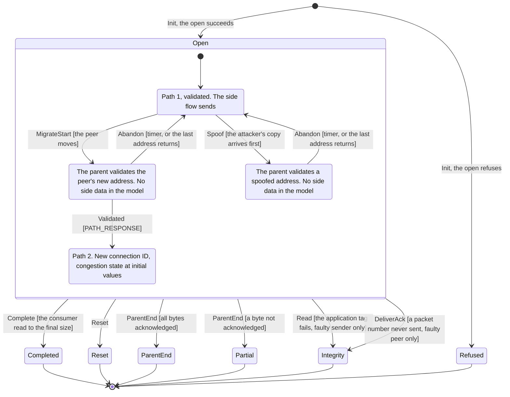

# Attached datagram channel: statechart

This diagram comes from `AttachedDatagram.tla` with `Bug = "none"`, the design selected on
2026-11-07. TLC checks the model; the diagram does not replace that check.

With an honest sender, no step reaches `Integrity`: the network and the on-path attacker can only
deliver, lose, duplicate, reorder, or send again a datagram that the sender sent
(`NoNetworkIntegrity`). The `AttachedDatagram.Integrity_reach` witness reaches `Integrity` with
a faulty sender.

What the diagram hides or merges:

- Each terminal state has the `Done` stuttering step. The diagram shows it as `[*]`.
- In `Open`, these steps do not change the state in the diagram: `SendData` (through `SendNext`), `Deliver`, `Replay`,
  `Lose`, `DeclareLost`, `DeliverAck` for a sent packet number, `DeliverCredit`, `Read` of a good
  byte, and `ParentLoss`. A datagram whose tag fails has no step: it changes no state.
- `Spoof` needs the on-path attacker (`OnPath`); `AttachedDatagram.NoOnPath.cfg` checks the model
  without it.
- `Complete` merges the receiver's completion and the acknowledgement frame that names the read
  point at the final size.
- `Reset`, `ParentEnd`, and the integrity steps can occur in each path phase. The diagram draws
  them once from `Open`.
- With `Paths = 2`, there is one migration attempt, genuine or spurious. With more paths, each
  attempt takes a new path, and the validated state repeats the cycle. `Abandon` returns to the
  last validated path with its congestion state; after an abandon, no further attempt is left at
  `Paths = 2`.
- The validating states merge the design's sending within the anti-amplification limit into "no
  side data" (README, "Reductions").
- The stream, credit, replay window, congestion window, and packet-number states are not shown.
  The README lists them.
- The known-bad variants (`Bug` other than `"none"`) add steps that the diagram does not show:
  `Forge`, `GrantBeyond`, `ResendSamePN`, and a `Reset` after a terminal outcome.
