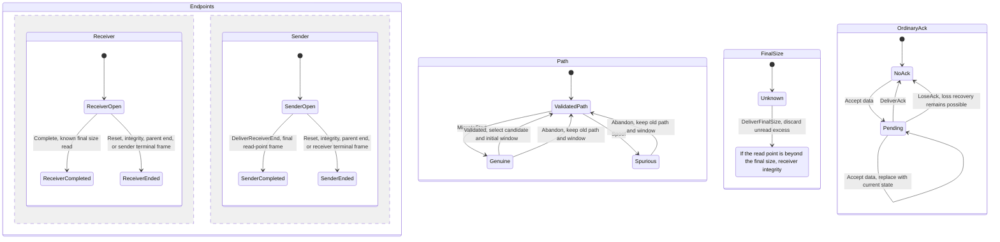

# Attached datagram channel: statechart

This diagram comes from `AttachedDatagram.tla` with `Bug = "none"`, through the design decisions
of 2026-11-11. TLC checks the model; the diagram does not replace that check.

Each endpoint keeps its first terminal outcome. The receiver can complete while the sender
resets, or the parent can fail before the final read-point frame arrives. The two local outcomes
then differ. Terminal-frame arrival changes only an open peer. The initial refusal at both ends
and `Done` stuttering are omitted from the diagram.

Migration can start again after success or abandonment; `Paths` does not bound the attempt
count. A spurious validation cannot succeed. In this model side sending pauses during validation,
so transfer progress assumes eventual path stability. Each validation must still end, independent
of that assumption. Production sending during validation and its anti-amplification admission are
outside this abstraction.

The diagram omits stream offsets, buffers, credit, packet numbers, replay state, the shared
congestion window, and most data steps. It combines each non-completion terminal outcome in
`ReceiverEnded` or `SenderEnded`; the model keeps reset, parent end, partial delivery, integrity,
and refusal distinct. It also omits all known-bad transitions. The [README](README.md) gives the
full correspondence, bounds, properties, and evidence.
